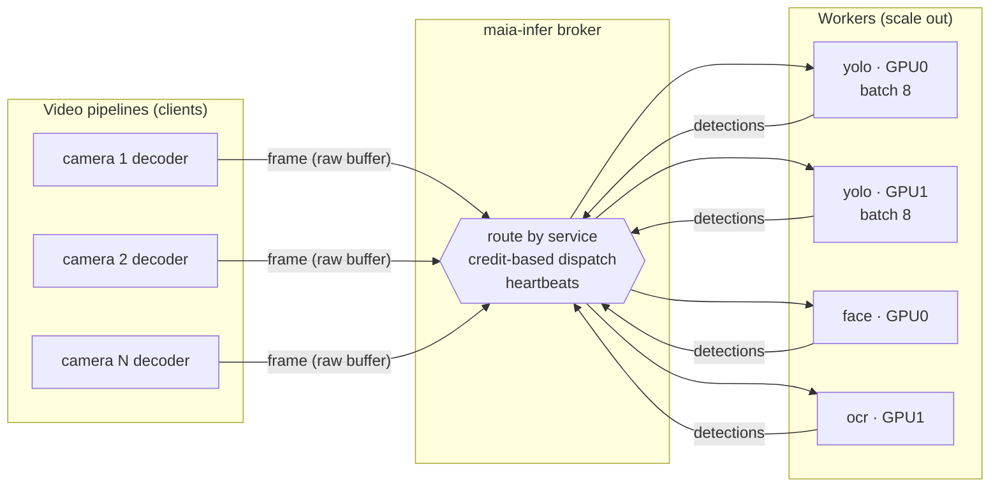

# maia-infer

**Lightweight model serving for real-time video analytics, over ZeroMQ.**

`maia-infer` puts your models (YOLO, classifiers, face, OCR, anything in Python) behind a
small broker. Video pipelines send raw frames and get results back in milliseconds, with no
HTTP stack, no base64 and no JSON-encoded images. Workers scale horizontally, batch
requests automatically, and drop out of rotation by themselves if they crash.

It is the inference layer of the **maia** suite: [`maia-face`](../maia-face) and
[`maia-ocr`](../maia-ocr) are workers built on it, and [`maia-platform`](../maia-platform)
uses it to run analytics on live camera streams.



## Why

Video analytics sends a lot of large, short-lived messages: a 720p frame is 2.8 MB, and a
dozen cameras at 5–10 FPS each means hundreds of them per second. The usual Flask/FastAPI
endpoint that takes a base64 image in JSON spends most of its time encoding and parsing.

| | HTTP + JSON/base64 | maia-infer |
|---|---|---|
| Frame encoding | base64 (+33% size) + JSON | raw buffer, zero-copy |
| Several models, one entry point | one server/port per model | route by service name |
| Load balancing | external (nginx, k8s) | built in, capacity-aware |
| Batching | hand-rolled | `max_batch` per worker |
| Crashed worker | requests hang or error until restarted | evicted after missed heartbeats |
| Unsafe deserialisation | n/a | no pickle: JSON header + numeric buffers only |

### Measured overhead

`bench/bench_transport.py` sends frames to a model that does nothing, so only transport cost
is measured. Single client, 2 vCPU Xeon @ 2.1 GHz, client, broker and server on one host:

| Frame | HTTP JSON+base64 | HTTP raw bytes | **maia-infer** |
|---|---|---|---|
| 720p (2.8 MB) | 26.3 ms · 36 req/s | 4.6 ms · 216 req/s | **2.3 ms · 413 req/s** |
| 1080p (6.2 MB) | 56.4 ms · 17 req/s | 7.1 ms · 139 req/s | **6.4 ms · 151 req/s** |

p50 latency. The biggest win is dropping base64/JSON (8–11×). Against raw-bytes HTTP the gain
is ~2× at 720p and shrinks at 1080p, where copying memory dominates; there, the reasons to
pick maia-infer are routing, batching and failure handling rather than raw speed. Run the
benchmark on your own hardware: `python bench/bench_transport.py --size 720p`.

**When not to use it:** if you need many model formats behind one optimised server
(TensorRT, ONNX, OpenVINO ensembles) or cross-network gRPC with a model repository, use
NVIDIA Triton. maia-infer is for Python models close to the pipeline, where you want full
control with very little machinery.

## Quick start

```bash
pip install "maia-infer[yolo] @ git+https://github.com/jemaia-elwrose/maia-infer"

maia-infer broker                                   # clients :5555, workers :5556
maia-infer worker examples.yolo_worker:YoloWorker \
    --max-batch 8 --opt model=yolov8m.pt --opt device=0
maia-infer ping && maia-infer stats
```

```python
import cv2
from maia_infer import Client

client = Client("tcp://localhost:5555", timeout_ms=2000)
frame = cv2.imread("street.jpg")
res = client.infer("yolo", frame, meta={"conf": 0.4, "classes": [0, 2]})
boxes = res.arrays[0]          # float32 (N, 6): x1, y1, x2, y2, conf, cls
```

Or with Docker (broker + GPU worker, then scale):

```bash
docker compose up --build
docker compose up --scale yolo=3
```

## Writing a worker

Load the model in `setup`, implement `predict` (one request) or `predict_batch` (many):

```python
from maia_infer import Worker, Result

class PlateClassifier(Worker):
    service = "plate-cls"
    max_batch = 16        # up to 16 crops per forward pass
    max_wait_ms = 3       # ...but never wait more than 3 ms to fill a batch

    def setup(self):
        self.model = load_model(self.options.get("weights", "plate_cls.onnx"))

    def predict_batch(self, requests):
        crops = [r.arrays[0] for r in requests]
        probs = self.model(crops)
        return [Result(meta={"label": int(p.argmax()), "score": float(p.max())}) for p in probs]
```

```bash
maia-infer worker my_workers:PlateClassifier --opt weights=models/plate_cls.onnx
```

A worker may return a `Result`, a NumPy array, a `dict` (metadata only) or `None`. If
`predict` raises, only that batch gets an error reply; the worker keeps serving.

## How it works

**Protocol.** Every message is `[JSON header, buffer, buffer, ...]`. The header carries
the request id, service, metadata and the dtype/shape of each buffer; buffers are raw array
bytes. Decoding validates dtypes and sizes and never executes anything.

**Broker.** Clients connect to a ROUTER socket, workers to another. Workers register with
`READY(service, capacity)`. The broker keeps a queue per service and sends work only to
workers that have free capacity (credits), round-robin. Each reply returns a credit. A
worker announcing `capacity=8` can receive up to 8 requests at once, which is what makes
micro-batching work without any extra coordination.

**Liveness.** Broker and workers exchange heartbeats. A worker that goes silent (GPU hang,
OOM kill, network cut) is evicted after `--worker-timeout` and its service stops receiving
traffic; a worker that loses the broker reconnects and re-registers by itself. Requests
waiting longer than their timeout are dropped in the broker instead of being processed
for a client that has already given up.

**Client.** Each call has a timeout and a retry budget. On timeout the socket is recreated,
so a late reply to an old request can never be confused with a new one. Note that a retried
request may run twice; keep inference side-effect free.

## Project layout

```
src/maia_infer/
  protocol.py   wire format (JSON header + raw buffers)
  broker.py     service routing, credits, heartbeats, stats
  worker.py     Worker base class, micro-batching, reconnects
  client.py     timeouts, retries, ping/stats
  cli.py        maia-infer broker | worker | ping | stats
examples/       YOLO worker, echo worker, video client
bench/          transport benchmark
tests/          protocol + end-to-end tests (broker/worker/client in threads)
```

## Development

```bash
pip install -e ".[dev]"
pytest -q            # 15 tests, ~7 s
ruff check . && ruff format --check .
```

## License

MIT
