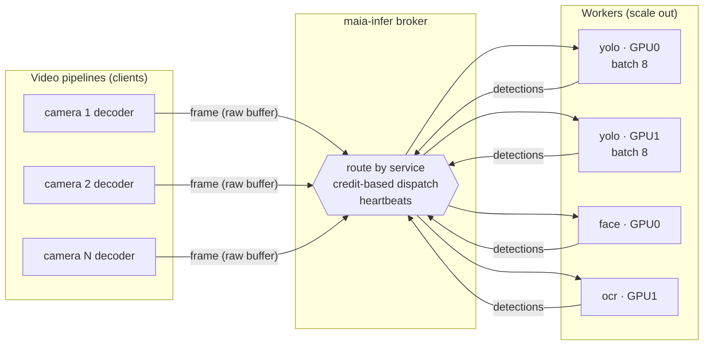

# maia-infer

**Lightweight model serving for real-time video analytics, over ZeroMQ.**

`maia-infer` puts your models (YOLO, classifiers, face, OCR, anything in Python) behind a
small broker. Video pipelines send raw frames and get results back in milliseconds, with no
HTTP stack, no base64 and no JSON-encoded images. Workers scale horizontally, batch
requests automatically, and drop out of rotation by themselves if they crash.

It is the inference layer of the **maia** suite: [`maia-face`](../maia-face) and
[`maia-ocr`](../maia-ocr) are workers built on it, and [`maia-platform`](../maia-platform)
uses it to run analytics on live camera streams.



## Why

Video analytics sends a lot of large, short-lived messages: a 720p frame is 2.8 MB, and a
dozen cameras at 5–10 FPS each means hundreds of them per second. The usual Flask/FastAPI
endpoint that takes a base64 image in JSON spends most of its time encoding and parsing.

| | HTTP + JSON/base64 | maia-infer |
|---|---|---|
| Frame encoding | base64 (+33% size) + JSON | raw buffer, zero-copy |
| Several models, one entry point | one server/port per model | route by service name |
| Load balancing | external (nginx, k8s) | built in, capacity-aware |
| Batching | hand-rolled | `max_batch` per worker |
| Crashed worker | requests hang or error until restarted | evicted after missed heartbeats |
| Unsafe deserialisation | n/a | no pickle: JSON header + numeric buffers only |

### Measured overhead

`bench/bench_transport.py` sends frames to a model that does nothing, so only transport cost
is measured. Single client, 2 vCPU Xeon @ 2.1 GHz, client, broker and server on one host:

| Frame | HTTP JSON+base64 | HTTP raw bytes | **maia-infer** |
|---|---|---|---|
| 720p (2.8 MB) | 26.3 ms · 36 req/s | 4.6 ms · 216 req/s | **2.3 ms · 413 req/s** |
| 1080p (6.2 MB) | 56.4 ms · 17 req/s | 7.1 ms · 139 req/s | **6.4 ms · 151 req/s** |

p50 latency. The biggest win is dropping base64/JSON (8–11×). Against raw-bytes HTTP the gain
is ~2× at 720p and shrinks at 1080p, where copying memory dominates; there, the reasons to
pick maia-infer are routing, batching and failure handling rather than raw speed. Run the
benchmark on your own hardware: `python bench/bench_transport.py --size 720p`.

**When not to use it:** if you need many model formats behind one optimised server
(TensorRT, ONNX, OpenVINO ensembles) or cross-network gRPC with a model repository, use
NVIDIA Triton. maia-infer is for Python models close to the pipeline, where you want full
control with very little machinery.

## Quick start

```bash
pip install "maia-infer[yolo] @ git+https://github.com/jemaia-elwrose/maia-infer"
#   or [rfdetr] for RF-DETR, or both: [yolo,rfdetr]

maia-infer broker                                    # clients :5555, workers :5556
maia-infer worker yolo --max-batch 8 --opt model=yolo11m.pt
maia-infer ping && maia-infer stats
```

```python
import cv2
from maia_infer import Client, detections

client = Client("tcp://localhost:5555", timeout_ms=2000)
frame = cv2.imread("street.jpg")  # BGR, as OpenCV gives it
res = client.infer("yolo", frame, meta={"conf": 0.4, "classes": ["person", "car"]})

boxes = res.arrays[0]  # float32 (N, 6): x1, y1, x2, y2, conf, class_id
for d in detections(res):  # or readable dicts: name, conf, box, class_id
    print(d["name"], d["conf"], d["box"])
```

Or with Docker (broker + GPU worker, then scale):

```bash
docker compose up --build
docker compose up --scale yolo=3
docker compose --profile rfdetr up     # add an RF-DETR worker
```

The GPU image is based on `pytorch/pytorch:2.11.0-cuda12.8-cudnn9-runtime`, which needs
NVIDIA driver 570 or newer (`nvidia-smi` shows yours). On an older driver, pick a matching
base: `docker compose build --build-arg BASE=pytorch/pytorch:2.9.1-cuda12.6-cudnn9-runtime`.

### Built-in workers

| Name | Model | Install extra | Notes |
|---|---|---|---|
| `yolo` | Ultralytics YOLO (v8, 11, ...) | `[yolo]` | `--opt model=yolo11m.pt --opt imgsz=640 --opt half=true` |
| `rfdetr` | [RF-DETR](https://github.com/roboflow/rf-detr) (Apache-2.0) | `[rfdetr]` | `--opt size=nano\|small\|medium\|base\|large`, `--opt weights=finetuned.pth` |
| `echo` | returns its input | - | smoke tests, benchmarks |

All detection workers share one output contract, so a pipeline can switch from YOLO to
RF-DETR by changing only the service name. Filter classes by **name**: class ids differ
between models (RF-DETR's pretrained checkpoints use COCO category ids, YOLO uses 0–79).

Run a few of each side by side on one broker and compare them on the same stream:

```bash
maia-infer worker yolo   --opt model=yolo11m.pt &
maia-infer worker rfdetr --opt size=medium &
python examples/video_client.py --source traffic.mp4 --service rfdetr
```

### Devices: NVIDIA, Apple Silicon, CPU

`--opt device=auto` (the default) picks CUDA, then Apple Silicon's GPU (MPS), then CPU.
Docker on macOS has no GPU access, so on a Mac run workers natively:

```bash
pip install "maia-infer[yolo,rfdetr] @ git+https://github.com/jemaia-elwrose/maia-infer"
export PYTORCH_ENABLE_MPS_FALLBACK=1   # CPU fallback for the few ops MPS lacks
maia-infer worker yolo --opt device=mps
```

The broker is plain Python, so a Mac (or any CPU box) can host it while workers run on a
remote GPU machine: point them at it with `--broker tcp://<mac-ip>:5556`.

## Writing a worker

Load the model in `setup`, implement `predict` (one request) or `predict_batch` (many):

```python
from maia_infer import Worker, Result


class PlateClassifier(Worker):
    service = "plate-cls"
    max_batch = 16  # up to 16 crops per forward pass
    max_wait_ms = 3  # ...but never wait more than 3 ms to fill a batch

    def setup(self):
        self.model = load_model(self.options.get("weights", "plate_cls.onnx"))

    def predict_batch(self, requests):
        crops = [r.arrays[0] for r in requests]
        probs = self.model(crops)
        return [Result(meta={"label": int(p.argmax()), "score": float(p.max())}) for p in probs]
```

```bash
maia-infer worker my_workers.py:PlateClassifier --opt weights=models/plate_cls.onnx
```

A worker can be referenced by built-in name (`yolo`), file (`path/to/file.py:Class`) or
importable module (`package.module:Class`). `examples/custom_worker.py` is a runnable template.
For a new detector, subclass `maia_infer.models.detection.DetectionWorker` and implement just
`load()` and `detect()`: batching, colour conversion, filtering and the output format are handled.

A worker may return a `Result`, a NumPy array, a `dict` (metadata only) or `None`. If
`predict` raises, only that batch gets an error reply; the worker keeps serving.

### Troubleshooting

**`ImportError: libxcb.so.1` (or `libGL.so.1`) when a worker starts.** Ultralytics pulls in
`opencv-python`, the desktop build of OpenCV, which needs GUI libraries that servers and
containers don't have. The GPU Docker image already handles this. On a bare server, run the
same fix once:

```bash
sh docker/fix-opencv.sh    # swaps in opencv-python-headless at the same version
```

**RF-DETR: `cannot import name 'BackboneConfigMixin' from 'transformers'`** (often after the
log line `Disabling PyTorch because PyTorch >= 2.6 is required`). RF-DETR uses transformers 5.x,
which needs PyTorch 2.6+. The `[rfdetr]` extra now requires it, so upgrade PyTorch.

## How it works

**Protocol.** Every message is `[JSON header, buffer, buffer, ...]`. The header carries
the request id, service, metadata and the dtype/shape of each buffer; buffers are raw array
bytes. Decoding validates dtypes and sizes and never executes anything.

**Broker.** Clients connect to a ROUTER socket, workers to another. Workers register with
`READY(service, capacity)`. The broker keeps a queue per service and sends work only to
workers that have free capacity (credits), round-robin. Each reply returns a credit. A
worker announcing `capacity=8` can receive up to 8 requests at once, which is what makes
micro-batching work without any extra coordination.

**Liveness.** Broker and workers exchange heartbeats. A worker that goes silent (GPU hang,
OOM kill, network cut) is evicted after `--worker-timeout` and its service stops receiving
traffic. Requests waiting longer than their timeout are dropped in the broker instead of being
processed for a client that has already given up.

**Restarts and shutdown.** If the broker goes away, workers keep their models loaded and
reconnect as soon as it is back, so you can restart or upgrade the broker without reloading
any GPU models. By default they wait forever, which is what you want under Docker or
Kubernetes. Pass `--give-up-after 60` (or set `MAIA_GIVE_UP_AFTER=60`) to make a worker exit
with code 1 instead. Ctrl+C and `docker stop` (SIGTERM) finish the current batch, tell the
broker the worker is leaving, and exit with code 0.

```text
WARNING lost contact with broker tcp://localhost:5556, reconnecting
INFO    still waiting for broker tcp://localhost:5556 (down 60s)
INFO    broker is back after 75s; worker 'yolo' registered again
```

**Client.** Each call has a timeout and a retry budget. On timeout the socket is recreated,
so a late reply to an old request can never be confused with a new one. Note that a retried
request may run twice; keep inference side-effect free.

## Project layout

```
src/maia_infer/
  protocol.py   wire format (JSON header + raw buffers)
  broker.py     service routing, credits, heartbeats, stats
  worker.py     Worker base class, micro-batching, reconnects, give-up
  signals.py    graceful Ctrl+C / SIGTERM
  client.py     timeouts, retries, ping/stats
  cli.py        maia-infer broker | worker | ping | stats
  models/       built-in workers: detection base, yolo, rfdetr, echo
examples/       video client, custom worker template
bench/          transport benchmark
tests/          protocol + end-to-end tests (broker/worker/client in threads)
```

## Development

```bash
pip install -e ".[dev]"
pytest -q            # 30 tests, ~30 s
ruff check . && ruff format --check .
```

## License

MIT
